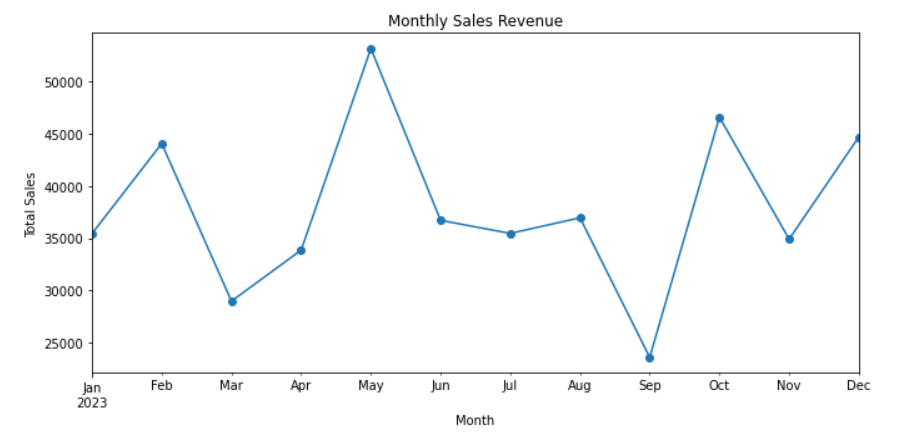
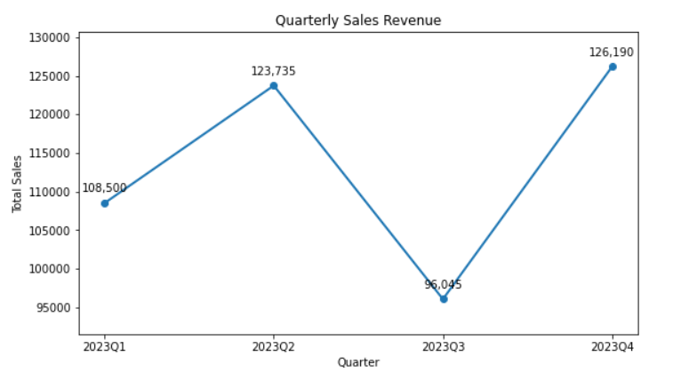
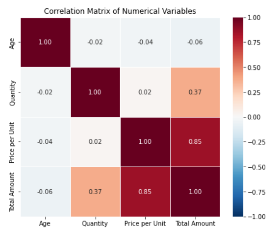
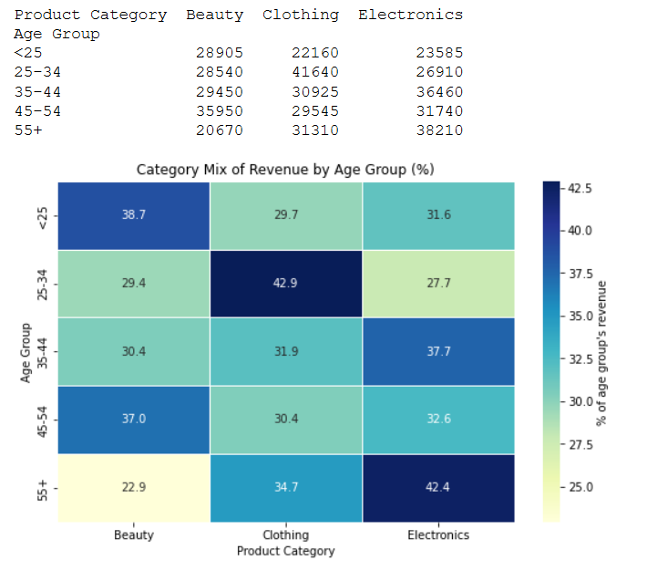

# Exploratory Data Analysis on Retail Sales Data

**Oasis Infobyte · Data Analytics Internship · Level 1 · Task 1**
**Author:** Ahmed Essam

## Objective
Perform an exploratory data analysis on a retail sales dataset to uncover sales patterns, customer behaviour and actionable business insights.

## Dataset
Retail Sales Dataset from Kaggle: 1,000 transactions and 9 columns (Transaction ID, Date, Customer ID, Gender, Age, Product Category, Quantity, Price per Unit, Total Amount).

## Tech Stack
Python, pandas, NumPy, matplotlib, seaborn, Jupyter Notebook

## What the Notebook Covers
- Initial inspection: shape, data types, null values
- Descriptive statistics (mean, median, mode, std)
- Monthly and quarterly sales trends
- Customer demographics: age groups and gender
- Product analysis: top 10 products and revenue by category
- Correlation heatmap
- Additional insights: category mix by age group, revenue concentration, average order value by weekday
- Conclusion with 5 business recommendations

## Key Findings
- Sales vary across the year, with a peak in May and the strongest quarter in Q4; September is the weakest month.
- Revenue is driven by price tier rather than units sold.
- Age does not predict how much customers spend, but it does relate to what they buy.
- The gender split is balanced (51% Female / 49% Male) with an almost identical average order value.

## Screenshots

## How to Run
1. Clone this repository.
2. Install the requirements: `pip install pandas numpy matplotlib seaborn notebook`
3. Run `jupyter notebook` and open `Retail_Sales_EDA.ipynb`.

## Files
- `Retail_Sales_EDA.ipynb`: the full analysis
- `retail_sales_dataset.csv`: the dataset
- `screenshots/`: key charts

## Demo Video
LinkedIn post: _link will be added after posting_